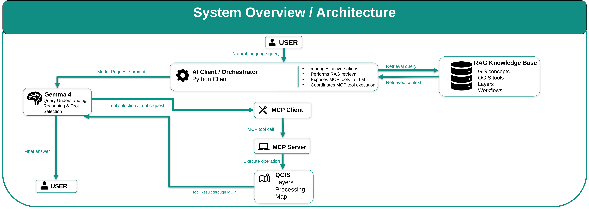
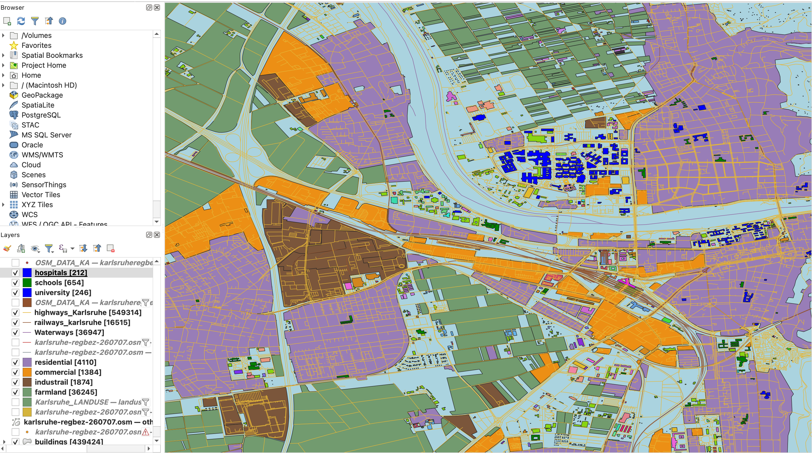

# A Local LLM-Based Geospatial Assistant Using MCP and RAG for Natural Language Spatial Queries

**Lab Rotation 2 | Karlsruhe Institute of Technology (KIT)**

**Researcher:** Aleena Sajan Abbas  
**Supervisor:** Dr.-Ing. Paul Vincent Kuper, Geodetic Institute

## Overview

This research explores the integration of a locally deployed Large Language Model (LLM), Model Context Protocol (MCP), and Retrieval-Augmented Generation (RAG) to enable natural-language interaction with QGIS.

The project aims to make GIS more accessible by allowing users to perform geospatial tasks through natural-language queries.

## Research Objectives

- Investigate how a local LLM can interpret natural-language GIS requests.
- Explore MCP-based interaction between an LLM and QGIS.
- Integrate RAG to retrieve relevant GIS and project-specific knowledge.
- Evaluate the performance of the integrated system.

## System Architecture

The proposed system integrates five main components:

1. **Local LLM:** Gemma 4 deployed through Ollama.
2. **RAG:** Retrieval of GIS concepts, layer information, CRS, attributes, tools, and workflows.
3. **MCP:** Communication between the AI client and QGIS tools.
4. **QGIS:** Spatial data access, map navigation, and supported geospatial operations.
5. **Python:** Orchestration of LLM interactions, retrieval, and tool execution.

### Workflow

User Query → Python AI Client → RAG + LLM → MCP → QGIS → Result

## Technologies Used

- Python
- QGIS
- Gemma 4
- Ollama
- Model Context Protocol (MCP)
- Retrieval-Augmented Generation (RAG)
- Large Language Models (LLMs)

## Experimental Evaluation

The system was evaluated using 16 integrated test-query executions.

| Result | Executions | Percentage |
|--------|------------|------------|
| Successful | 14 | 87.5% |
| Partial | 1 | 6.25% |
| Failed | 1 | 6.25% |

### Example: Zoom to the Hospitals Layer

**User Query:** "Zoom to the hospitals layer."

**RAG:**
Retrieved relevant information about the `get_layers` and `zoom_to_layer` tools.

**MCP:**
Executed `get_layers` followed by `zoom_to_layer`.

**QGIS Result:**
Successfully navigated to the hospitals layer containing 212 hospital features.

### QGIS Demonstration

The QGIS project used for experimental evaluation
contains OpenStreetMap-derived spatial layers,
including hospitals, schools, roads, and land use.

## Limitations

- Evaluation focused on selected GIS operations.
- Limited coverage of available MCP tools.
- Restricted scope of the RAG knowledge base.
- No advanced workflow planning or automatic error recovery.

## Future Work

- Expand MCP tool capabilities.
- Improve retrieval relevance.
- Evaluate complex spatial analysis workflows.
- Investigate automated error recovery.

## Research Context

This project was conducted as part of Lab Rotation 2 in the MSc Remote Sensing and Geoinformatics programme at Karlsruhe Institute of Technology (KIT), Germany.

## Repository Status

This repository contains the completed implementation and documentation of my Lab Rotation 2 research project at Karlsruhe Institute of Technology (KIT).

The project includes the Python-based LLM client, MCP server, QGIS plugin, RAG retriever, system architecture, and experimental results.

The research was completed and presented as part of the MSc Remote Sensing and Geoinformatics programme.